and [`vortex-frontend`](https://github.com/vortex-protocol/vortex-frontend).

---

## Security

Please report vulnerabilities via [`SECURITY.md`](./SECURITY.md). A draft
bug-bounty program, scoped to that document’s Assets at Risk table, lives
in [`docs/bug-bounty-program.md`](./docs/bug-bounty-program.md). The
program is unfunded (`REAL_MONEY=false`) until treasury infrastructure
can pay rewards.

---

## Glossary

| Term | Definition |
|------|------------|
| **Intent** | A user's signed request to swap tokens cross-chain (e.g. "send 1 ETH on Ethereum, receive ≥ 3 500 USDC on Stellar"). An intent carries the source chain/token/amount, the desired destination token, a minimum acceptable output, and a deadline. It does not lock any Stellar funds — the user initiates the source-chain transfer separately. |
| **Solver** | An off-chain market maker that monitors open intents, executes the cross-chain leg, and calls `fill_intent` to settle on Stellar. Solvers must post a USDC bond before they can accept any intent. |
| **Bond** | USDC collateral locked by a solver via `register_solver`. The minimum is 50 USDC (`MIN_BOND`). The bond backs the solver's fill obligation: failing to fill after accepting an intent results in a partial slash. |
| **Fill window** | The time a solver has to deliver output tokens after calling `accept_intent`. Currently 5 minutes (`FILL_WINDOW = 300 s`). If the window expires without a fill, anyone may call `slash_solver` to penalise the solver and re-open the intent. |
| **Slash** | A penalty applied to a solver's bond when they accept an intent but miss the fill window. 10% of the bond is transferred to the fee recipient; the intent reverts to `Open` with a fresh deadline and is re-auctioned. |
| **Intent state** | One of `Open`, `Accepted`, `PartiallyFilled`, `Filled`, `Cancelled`, `Expired`, or `Slashed`. See the lifecycle diagram below for valid transitions. |
| **dst_token** | The destination token on Stellar (a SAC or SEP-41 contract address) that the solver must transfer to the user to settle an intent. |
| **src_chain** | The source blockchain (e.g. `"ethereum"`, `"base"`) where the user is sending funds. Free-text; validated against an optional allowlist. |

---

## Contracts

### `intent_settlement`

Core protocol logic (`intent_settlement/src/lib.rs`):

- `submit_intent()` — user creates a swap intent
- `accept_intent()` — solver claims exclusive fill rights
- `fill_intent()` — solver delivers output tokens to the user
- `cancel_intent()` — user cancels an open intent
- `expire_intent()` — permissionless: materializes an unfilled intent's expiry
- `slash_solver()` — permissionless: slashes a solver that failed to fill
- `batch_submit_intent()` / `batch_accept_intent()` / `batch_fill_intent()` / `batch_cancel_intent()` — process up to `MAX_BATCH_SIZE` intents in one transaction; a failure on any item reverts the whole batch (#199)
- `register_solver()` / `deregister_solver()` / `withdraw_bond()` — solver bond management
- `get_solver()` / `get_solver_count()` / `list_solvers(start, limit)` — read solver records; `list_solvers` paginates the registered-solver set so integrators don't have to replay events (#198)
- `propose_fee_recipient()` / `accept_fee_recipient()` — timelocked fee-recipient handover (#115, #116)
- `propose_admin_transfer()` / `accept_admin_transfer()` — timelocked admin-key handover (#115, #116)
- `pause()` / `unpause()` — admin-only incident response
- `propose_add_dst_token()` / `execute_add_dst_token()` / `propose_remove_dst_token()` / `execute_remove_dst_token()` / `set_dst_allowlist_enabled()` — timelocked dst_token allowlist changes (#115, #116, #118)
- `list_allowed_dst_tokens()` — enumerate the full current dst_token allowlist (#117)
- `add_allowed_src_chain()` / `remove_allowed_src_chain()` / `set_src_chain_allowlist_enabled()` — optional src_chain allowlist (#34)
- `set_solver_registry()` / `get_solver_registry()` — optional `solver_registry` link; when set, `accept_intent` grants tier fill-window bonuses and `slash_solver` applies tier slash rates. Unset ⇒ every solver is Unranked (pre-integration behaviour) (#197)
- `rescue_tokens()` — admin-only recovery of non-bond tokens accidentally sent to the contract (#35)
- `propose_upgrade()` / `execute_upgrade()` / `get_pending_upgrade()` / `migrate()` — timelocked in-place contract upgrade + one-time storage-migration hook (#194)
- `set_fee_discount_tiers()` / `get_fee_schedule()` — volume-tier protocol-fee discounts for solvers (#192)

#### Protocol fee & volume-tier discounts (#192)

`fill_intent` charges a protocol fee, paid by the solver, on each fill:

```
fee = fill_amount * effective_fee_bps / 10_000
```

The base rate is `ProtocolConfig.protocol_fee_bps` (default **5 bps = 0.05%**,
admin-tunable via `set_config`, hard-capped at 1 000 bps / 10%).

High-volume solvers can earn a discount on that base rate. The admin sets a
**data-driven discount schedule** — an ordered list of
`(min_volume, discount_bps)` tiers, ascending by `min_volume`:

```bash
# 1M dst-token cumulative volume ⇒ 20% off the fee; 10M ⇒ 50% off.
stellar contract invoke --id <CONTRACT_ID> --source <ADMIN_SECRET_KEY> --network testnet -- \
  set_fee_discount_tiers --tiers '[[10000000000,2000],[100000000000,5000]]'
```

- `discount_bps` is a fraction **of the fee**, in hundredths of a percent
  (`2000` = 20% off, `10000` = fee waived entirely).
- A solver pays the base rate reduced by the highest tier whose `min_volume`
  their cumulative `SolverRecord.total_volume` has reached (`>=`, inclusive).
- The effective rate is always clamped to `0 ..= base` — a discount can never
  make the fee negative or larger than the un-discounted rate.
- With **no schedule set (the default)** every solver pays the flat base rate,
  so this is fully backward-compatible.
- `set_fee_discount_tiers` rejects (`InvalidFeeTiers`) a schedule that isn't
  strictly ascending by `min_volume` or has any `discount_bps > 10 000`. Pass
  an empty list to clear all discounts.
- Solver bots can call `get_fee_schedule(solver)` to read `(tiers,
  effective_fee_bps)` and price a fill before submitting.

#### Usage examples

All examples use the [Stellar CLI](https://developers.stellar.org/docs/tools/developer-tools/cli/stellar-cli)
against a deployed contract. Swap `<CONTRACT_ID>` and `<SECRET_KEY>` for your
deployment; addresses shown are placeholders.

For a complete guide on building an off-chain solver bot (event subscription,
eligibility checks, accept/fill flow), see
[`docs/solver-integration-guide.md`](./docs/solver-integration-guide.md).

```bash
# User submits a swap intent: 1 ETH on Ethereum for at least 3500 USDC on Stellar
stellar contract invoke --id <CONTRACT_ID> --source <SECRET_KEY> --network testnet -- \
  submit_intent \
  --user <USER_ADDRESS> \
  --src_chain '"ethereum"' \
  --src_token '"0xC02aaA39b223FE8D0A0e5C4F27eAD9083C756Cc2"' \
  --src_amount 1000000000000000000 \
  --dst_token <USDC_SAC_ADDRESS> \
  --min_dst_amount 35000000000

# Solver registers with a 50 USDC bond (MIN_BOND)
stellar contract invoke --id <CONTRACT_ID> --source <SOLVER_SECRET_KEY> --network testnet -- \
  register_solver --solver <SOLVER_ADDRESS> --bond_amount 500000000

# Solver claims exclusive fill rights on an intent
stellar contract invoke --id <CONTRACT_ID> --source <SOLVER_SECRET_KEY> --network testnet -- \
  accept_intent --solver <SOLVER_ADDRESS> --intent_id <INTENT_ID>

# Read-only: solver self-checks that fill_intent would succeed before spending a transaction
stellar contract invoke --id <CONTRACT_ID> --source <ANY_SECRET_KEY> --network testnet -- \
  is_intent_fillable --intent_id <INTENT_ID> --solver <SOLVER_ADDRESS>

# Solver delivers the output and closes out the intent
stellar contract invoke --id <CONTRACT_ID> --source <SOLVER_SECRET_KEY> --network testnet -- \
  fill_intent --solver <SOLVER_ADDRESS> --intent_id <INTENT_ID> --fill_amount 35000000000

# Anyone can slash a solver that accepted but missed the fill window
stellar contract invoke --id <CONTRACT_ID> --source <ANY_SECRET_KEY> --network testnet -- \
  slash_solver --intent_id <INTENT_ID>

# Read-only: check current protocol stats
stellar contract invoke --id <CONTRACT_ID> --source <ANY_SECRET_KEY> --network testnet -- \
  get_stats
```

##### CLI Helper Script

To reduce boilerplate when invoking the contract during local testing, use the
CLI helper script at `scripts/invoke.sh`. It wraps the Stellar CLI invocations
above and reads common parameters from environment variables or a config file:

```bash
# Copy the example config and fill in your values
cp scripts/.env.local.example .env.local
# Edit .env.local with your CONTRACT_ID, SECRET_KEY, and NETWORK

# Now invoke commands via the helper (no need to repeat contract ID or key)
./scripts/invoke.sh register_solver --solver <SOLVER_ADDRESS> --bond_amount 500000000
./scripts/invoke.sh submit_intent --user <USER_ADDRESS> --src_chain ethereum \
  --src_token '0xC02aaA39b223FE8D0A0e5C4F27eAD9083C756Cc2' \
  --src_amount 1000000000000000000 --dst_token <USDC_SAC_ADDRESS> \
  --min_dst_amount 35000000000
./scripts/invoke.sh accept_intent --solver <SOLVER_ADDRESS> --intent_id <INTENT_ID>
./scripts/invoke.sh fill_intent --solver <SOLVER_ADDRESS> --intent_id <INTENT_ID> \
  --fill_amount 35000000000
./scripts/invoke.sh get_stats
```

See `./scripts/invoke.sh --help` for the full list of supported commands.

#### Decimal Normalization for `src_amount`

`src_amount` must be expressed in the **source token's smallest indivisible
unit** — the same convention used by the chain's native token representation.
This varies significantly across chains and tokens, so off-chain tooling that
builds `submit_intent` calls must apply the correct multiplier before
submitting.

**General rule:**

```
src_amount = human_amount × 10^decimals
```

**Worked examples:**

| Chain | Token | Decimals | Human amount | `src_amount` value |
|---|---|---|---|---|
| Ethereum | ETH (WETH) | 18 | 1 ETH | `1_000_000_000_000_000_000` |
| Ethereum | USDC | 6 | 500 USDC | `500_000_000` |
| Base | ETH (native) | 18 | 0.5 ETH | `500_000_000_000_000_000` |
| Base | USDC | 6 | 100 USDC | `100_000_000` |
| Polygon | MATIC | 18 | 200 MATIC | `200_000_000_000_000_000_000` |
| Polygon | USDC.e | 6 | 1000 USDC | `1_000_000_000` |
| Avalanche | AVAX | 18 | 10 AVAX | `10_000_000_000_000_000_000` |
| Arbitrum | USDC | 6 | 250 USDC | `250_000_000` |
| BSC | BNB | 18 | 2 BNB | `2_000_000_000_000_000_000` |
| BSC | USDT | 18 | 50 USDT | `50_000_000_000_000_000_000` |
| Solana | USDC (SPL) | 6 | 500 USDC | `500_000_000` |
| Solana | wSOL | 9 | 3 SOL | `3_000_000_000` |
| Solana | BONK | 5 | 1 000 000 BONK | `100_000_000_000` |

The existing README usage example (`src_amount 1000000000000000000` for
1 ETH on Ethereum) follows this convention.

> **Pitfall — USDC on BSC is 18 decimals**, not 6. Always read the deployed
> contract's `decimals()` function rather than assuming a standard value. Most
> stablecoins on EVM chains are 6 decimals except on BSC, where USDT and BUSD
> are 18.

> **Solana — decimals are per-mint, not per-chain.** SPL mints set their own
> decimals: USDC/USDT are 6, wrapped SOL and most LSTs are 9, BONK is 5. Read
> the mint account's `decimals`; don't assume. See
> [docs/132-supported-chains.md §3.2 and §4.8](./docs/132-supported-chains.md).

**On-chain bound:** `src_amount` is stored as `i128`. The contract enforces
`src_amount <= MAX_AMOUNT` (`10^30`), which accommodates amounts up to
one trillion 18-decimal tokens. Any value above this threshold causes
`submit_intent` to return `Error::AmountTooLarge` (the dedicated out-of-range
guard; `ZeroAmount` still covers non-positive values).

**Decimals-aware `min_dst_amount` guard (#252):** in addition to the flat
`MAX_AMOUNT` bound, `submit_intent` queries `dst_token`'s own `decimals()`
and rejects a `min_dst_amount` that implies more than `MAX_WHOLE_UNITS`
(one trillion) whole `dst_token` units at that precision, raising
`Error::ImplausibleDstAmount`. This is a ceiling-only heuristic — it exists
to catch a `min_dst_amount` scaled for the wrong decimals class (e.g. an
18-decimal-scaled amount submitted for a 7-decimal token), not to enforce a
dust floor, since a legitimate micro-intent on a low-decimal token is
indistinguishable on-chain from a genuine mistake without off-chain price
context. A `dst_token` whose `decimals()` call itself fails (not a real
SEP-41 token) causes `submit_intent` to trap and revert, the same as
`propose_add_dst_token`'s existing interface probe.

**Stellar side (`min_dst_amount`):** Stellar USDC (Circle's SAC) uses
**7 decimals** (Stellar's native precision). So 3500 USDC on Stellar is
`35_000_000_000` (3500 × 10^7).

```bash
# 1 ETH  → at least 3500 USDC on Stellar
# src_amount:     1 * 10^18 = 1000000000000000000   (ETH, 18 decimals)
# min_dst_amount: 3500 * 10^7 = 35000000000          (USDC SAC, 7 decimals)
stellar contract invoke --id <CONTRACT_ID> --source <SECRET_KEY> --network testnet -- \
  submit_intent \
  --src_chain '"ethereum"' \
  --src_token '"0xC02aaA39b223FE8D0A0e5C4F27eAD9083C756Cc2"' \
  --src_amount 1000000000000000000 \
  --dst_token <USDC_SAC_ADDRESS> \
  --min_dst_amount 35000000000
```

---

#### Intent Lifecycle

The diagram below covers every `IntentState` variant and the functions that
drive each transition, including the competitive bid window (issue #191) and the
escrow / dispute-resolution flow (issue #188).

```mermaid
stateDiagram-v2
    [*] --> Open : submit_intent()\n[bid window disabled]
    [*] --> Bidding : submit_intent()\n[bid window enabled]

    Bidding --> Accepted : settle_bids()\n[best bid, bidder still eligible,\n now >= bid deadline]
    Bidding --> Open : settle_bids()\n[no usable bid]
    Open --> Bidding : (never — one-way)

    Open --> Accepted : accept_intent()\n[solver registered & active,\n deadline not reached]
    Open --> Cancelled : cancel_intent()\n[caller == intent.user]
    Open --> Expired : expire_intent()\n[now >= deadline]

    Accepted --> Filled : fill_intent()\n[fill_amount >= min_dst_amount,\n now < deadline]
    Accepted --> PartiallyFilled : fill_intent()\n[partial fill]
    Accepted --> Filling : begin_fill()\n[completing fill into escrow,\n starts dispute window]
    Accepted --> Open : slash_solver()\n[now >= deadline]\n(bond slashed proportionally,\nintent re-opened with fresh deadline)

    Filling --> Filled : release_fill()\n[now >= dispute_deadline,\n no dispute]
    Filling --> Disputed : dispute_fill()\n[caller == intent.user,\n within dispute window]

    Disputed --> Resolved : resolve_dispute()\n[arbiter; Upheld slashes solver,\n Dismissed does not — user paid either way]
    Disputed --> Resolved : release_fill()\n[now >= arbiter timeout;\n full escrow to user, no slash]

    Filled --> [*]
    Cancelled --> [*]
    Expired --> [*]
    Resolved --> [*]
```



> **Note:** `accept_intent` also lazily sets state to `Expired` (and panics)
> when the intent's original deadline has already passed, but this is a
> read-time guard, not a persisted `Open → Expired` path — that explicit
> transition is handled by `expire_intent`.

---

#### Error Reference

Every `Error` variant that `intent_settlement` can raise is listed below.
The table is generated from the enum in `intent_settlement/src/lib.rs` by
[`scripts/generate-error-reference.py`](../scripts/generate-error-reference.py)
so that it cannot drift from the source.

<!-- BEGIN GENERATED: error-reference -->

This table is **generated** from `intent_settlement/src/lib.rs` by
[`scripts/generate-error-reference.py`](../scripts/generate-error-reference.py)
 — run `python3 scripts/generate-error-reference.py --check` to
verify it is still in sync with the enum.

The `Error` enum declares **127 variants**
(**95 distinct names**). Every declaration gets its own
row below, in the order the enum declares them; the `Code` column
is the on-chain discriminant. The `Condition` column is the
variant's own rustdoc, so the README and the source cannot
disagree about what a variant means.

`Raised by` lists the contract entry points that can surface the error —
including the ones that only reach it through an internal
helper. It is derived from a call graph of the contract, not from
a hand-written list. A `—` means the variant is declared but
never raised anywhere in `intent_settlement/src/lib.rs`.

| # | Variant | Code | Raised by | Condition |
|---|---------|------|-----------|-----------|
| 1 | `AlreadyInitialized` | 1 | `initialize` | `initialize` was called on a contract that already has an `Admin` key in instance storage. Raised exclusively by `initialize`. |
| 2 | `Unauthorized` | 2 | `accept_admin_transfer`, `accept_fee_recipient`, `amend_intent`, `batch_cancel_intent`, `batch_fill_intent`, `begin_fill`, `cancel_intent`, `dispute_fill`, `execute_upgrade`, `fill_intent`, `get_solver_intents`, `open_dispute`, `pause`, `release_fill`, `request_extension`, `resolve_dispute` | A privileged operation was attempted by a caller who is not the required authority. Raised by `fill_intent` when the caller is not the solver that accepted the intent, and by `cancel_intent` when the caller is not the intent's owner. |
| 3 | `IntentNotFound` | 3 | `accept_intent`, `accept_intent_with_bond`, `amend_intent`, `batch_accept_intent`, `batch_cancel_intent`, `batch_fill_intent`, `begin_fill`, `bid_intent`, `cancel_intent`, `claim_backstop_compensation`, `close_intent`, `current_min_dst`, `dispute_fill`, `expire_intent`, `fill_intent`, `get_solver_intents`, `open_dispute`, `release_fill`, `request_extension`, `resolve_dispute`, `settle_bids`, `slash_solver` | The supplied `intent_id` has no corresponding `IntentRecord` in persistent storage. Raised by `accept_intent`, `fill_intent`, `cancel_intent`, `slash_solver`, and `expire_intent`. |
| 4 | `IntentNotOpen` | 4 | `accept_intent`, `accept_intent_with_bond`, `accept_outbound_intent`, `batch_accept_intent`, `batch_cancel_intent`, `batch_fill_intent`, `begin_fill`, `cancel_intent`, `expire_intent`, `fill_intent`, `release_fill`, `resolve_dispute` | The intent's `state` is not `Open` at a point where `Open` is required. Raised by `cancel_intent` (non-`Open`/non-`Accepted` guard) and by `expire_intent` (which only operates on `Open` intents). |
| 5 | `IntentExpired` | 5 | `accept_intent`, `accept_intent_with_bond`, `accept_outbound_intent`, `batch_accept_intent`, `batch_cancel_intent`, `batch_fill_intent`, `fill_intent` | The current ledger timestamp has reached or passed the intent's `deadline` when a solver tries to accept it via `accept_intent`. The intent's state is lazily updated to `Expired` before the panic. |
| 6 | `IntentNotAccepted` | 6 | `batch_cancel_intent`, `batch_fill_intent`, `begin_fill`, `claim_backstop_compensation`, `fill_intent`, `get_solver_intents`, `release_fill`, `request_extension`, `resolve_dispute`, `slash_solver` | `fill_intent` or `slash_solver` requires the intent to be in state `Accepted`, but it is in a different terminal or intermediate state. Also raised by `slash_solver` when `intent.state != Accepted`. |
| 7 | `SolverNotRegistered` | 7 | `accept_intent`, `accept_intent_with_bond`, `batch_accept_intent`, `batch_cancel_intent`, `batch_fill_intent`, `deregister_solver`, `fill_intent`, `withdraw_bond`, `withdraw_bond_token` | An operation that requires a registered solver (e.g. `deregister_solver`, `withdraw_bond`, `accept_intent`) was called for an address that has no `SolverRecord` in persistent storage. |
| 8 | `SolverBondTooLow` | 8 | `accept_intent`, `accept_intent_with_bond`, `accept_outbound_intent`, `batch_accept_intent`, `batch_cancel_intent`, `batch_fill_intent`, `fill_intent`, `register_solver`, `register_solver_with_token`, `withdraw_bond`, `withdraw_bond_token` | `register_solver` was called with a `bond_amount` that, when added to any existing bond, does not reach `MIN_BOND` (500_000_000 stroops / 50 USDC). Also raised by `withdraw_bond` when the post-withdrawal balance would fall below `MIN_BOND`. |
| 9 | `InsufficientOutput` | 9 | `batch_cancel_intent`, `batch_fill_intent`, `begin_fill`, `fill_intent`, `release_fill`, `resolve_dispute` | `fill_intent` was called with a `fill_amount` less than the intent's `min_dst_amount`. Raised only in `fill_intent`. |
| 10 | `FillWindowExpired` | 10 | `batch_cancel_intent`, `batch_fill_intent`, `begin_fill`, `fill_intent`, `get_solver_intents`, `release_fill`, `resolve_dispute`, `slash_solver` | `fill_intent` was called after the intent's `deadline` (i.e. the fill window that starts when the solver calls `accept_intent` and lasts `FILL_WINDOW` seconds) has already elapsed. Also (confusingly) used in `slash_solver` as a guard label when the fill window has *not yet* expired — the intent cannot be slashed before its deadline. |
| 11 | `CannotCancelAccepted` | 11 | `batch_cancel_intent`, `batch_fill_intent`, `cancel_intent`, `fill_intent` | `cancel_intent` was called on an intent in state `Accepted`. Users may only cancel `Open` intents; once a solver has accepted, the `slash_solver` path must be used if the solver fails to fill. |
| 12 | `SolverInactive` | 12 | `accept_intent`, `accept_intent_with_bond`, `batch_accept_intent`, `batch_cancel_intent`, `batch_fill_intent`, `begin_fill`, `bid_intent`, `fill_intent`, `release_fill`, `resolve_dispute` | `accept_intent` was called for a solver whose `is_active` flag is `false` (set when the bond falls below `MIN_BOND` after a slash, or after calling `deregister_solver`). |
| 13 | `ZeroAmount` | 13 | `batch_cancel_intent`, `batch_fill_intent`, `batch_submit_intent`, `begin_fill`, `bid_intent`, `fill_intent`, `register_solver`, `register_solver_with_token`, `release_fill`, `rescue_tokens`, `resolve_dispute`, `set_bond_token_min`, `set_min_bond_multiplier`, `submit_intent`, `submit_outbound_intent`, `withdraw_bond`, `withdraw_bond_token` | A numeric input that must be strictly positive was zero or negative. Raised by `submit_intent` (`src_amount` or `min_dst_amount ≤ 0`) and by `register_solver` / `withdraw_bond` (`bond_amount ≤ 0`). |
| 14 | `InvalidDeadline` | 14 | `batch_cancel_intent`, `batch_fill_intent`, `batch_submit_intent`, `fill_intent`, `submit_intent`, `submit_outbound_intent` | `submit_intent` was called with a `deadline` that is already in the past (i.e. `deadline ≤ env.ledger().timestamp()`). |
| 15 | `IntentAlreadyFilled` | 15 | `batch_cancel_intent`, `batch_fill_intent`, `fill_intent`, `get_solver_intents` | `fill_intent` was called on an intent that is already in state `Filled`. |
| 16 | `NotInitialized` | 16 | `accept_intent`, `accept_intent_with_bond`, `add_allowed_bond_token`, `add_allowed_src_chain`, `batch_accept_intent`, `batch_cancel_intent`, `batch_fill_intent`, `batch_submit_intent`, `begin_fill`, `cancel_pending_dst_token_add`, `cancel_pending_dst_token_remove`, `claim_backstop_compensation`, `deregister_solver`, `execute_chain_offboarding`, `execute_chain_onboarding`, `execute_set_policy`, `execute_upgrade`, `fill_intent`, `get_arbiter`, `get_bond_token_min`, `get_solver_bond`, `get_solver_bonds`, `get_solver_intents`, `is_allowed_bond_token`, `migrate`, `pause`, `propose_add_dst_token`, `propose_admin_transfer`, `propose_chain_onboarding`, `propose_fee_recipient`, `propose_oracle`, `propose_remove_dst_token`, `propose_set_policy`, `propose_upgrade`, `register_solver`, `register_solver_with_token`, `release_fill`, `remove_allowed_bond_token`, `remove_allowed_src_chain`, `rescue_tokens`, `resolve_dispute`, `set_arbiter`, `set_bid_window_enabled`, `set_bond_token_min`, `set_config`, `set_dst_allowlist_enabled`, `set_intent_retention`, `set_min_bond_multiplier`, `set_pauser`, `set_proof_registry`, `set_src_chain_allowlist_enabled`, `settle_bids`, `slash_solver`, `submit_intent`, `submit_outbound_intent`, `unpause`, `withdraw_bond`, `withdraw_bond_token` | An operation that requires the contract to be initialized (i.e. needs `Admin` in instance storage) was called before `initialize`. Raised by `require_admin` and by `propose_fee_recipient` / `propose_admin_transfer`. |
| 17 | `SolverHasActiveIntents` | 17 | `deregister_solver`, `withdraw_bond`, `withdraw_bond_token` | `deregister_solver` was called while the solver's `active_intents` counter is greater than zero, meaning at least one intent is currently in state `Accepted` by this solver. The solver must wait for those intents to reach a terminal state first. |
| 18 | `ContractPaused` | 18 | `accept_intent`, `accept_intent_with_bond`, `batch_accept_intent`, `batch_cancel_intent`, `batch_fill_intent`, `batch_submit_intent`, `begin_fill`, `bid_intent`, `deregister_solver`, `fill_intent`, `get_solver_intents`, `register_solver`, `register_solver_with_token`, `release_fill`, `resolve_dispute`, `submit_intent`, `submit_intent_signed`, `withdraw_bond`, `withdraw_bond_token` | `submit_intent`, `accept_intent`, or `fill_intent` was called while the contract's `Paused` flag is `true`. Raised by `require_not_paused`. |
| 19 | `DeadlineNotReached` | 19 | `batch_cancel_intent`, `batch_fill_intent`, `begin_fill`, `expire_intent`, `fill_intent`, `release_fill`, `resolve_dispute` | `expire_intent` was called before the intent's `deadline` has been reached (i.e. `env.ledger().timestamp() < intent.deadline`). |
| 20 | `InsufficientBond` | 20 | `withdraw_bond`, `withdraw_bond_token` | `withdraw_bond` was called with an `amount` greater than the solver's current `bond_amount`. |
| 21 | `DstTokenNotAllowed` | 21 | `batch_cancel_intent`, `batch_fill_intent`, `batch_submit_intent`, `fill_intent`, `submit_intent` | `submit_intent` was called with a `dst_token` that is not present in the `AllowedDstToken` allowlist while `DstAllowlistEnabled` is `true`. |
| 22 | `IntentAlreadyExists` | 22 | `batch_cancel_intent`, `batch_fill_intent`, `batch_submit_intent`, `fill_intent`, `submit_intent`, `submit_outbound_intent` | Duplicate `intent_id` detected in `submit_intent` (hash collision guard). |
| 23 | `FeeOverflow` | 23 | `batch_cancel_intent`, `batch_fill_intent`, `begin_fill`, `fill_intent`, `release_fill`, `resolve_dispute` | #31: fee arithmetic overflowed (fill_amount is astronomically large) |
| 24 | `InvalidTokenInterface` | 24 | — | #33: the address passed to `propose_add_dst_token` doesn't implement SEP-41 |
| 25 | `NoPendingFeeRecipient` | 25 | `accept_fee_recipient`, `cancel_pending_fee_recipient` | #30: `accept_fee_recipient` was called with no pending fee-recipient proposal in storage. |
| 26 | `SrcChainNotAllowed` | 26 | `batch_cancel_intent`, `batch_fill_intent`, `batch_submit_intent`, `fill_intent`, `submit_intent` | #34: `submit_intent` was called with a `src_chain` that is not on the allowlist while `SrcChainAllowlistEnabled` is `true`. |
| 27 | `RescueProtectedToken` | 27 | `rescue_tokens` | #35: `rescue_tokens` was called for the bond token, which the rescue path is not allowed to move. |
| 28 | `InvalidSrcToken` | 28 | `batch_cancel_intent`, `batch_fill_intent`, `batch_submit_intent`, `fill_intent`, `get_solver_intents`, `submit_intent` | #127: `submit_intent` was called with a `src_token` whose format does not match the conventions of the declared `src_chain`. EVM chains (ethereum, base, polygon, arbitrum, optimism): expect a `0x`-prefixed 42-character hex string (e.g. `"0xA0b86991…"`). Solana: expects a base58 string between 32 and 44 characters long with no `0x` prefix. If `src_chain` is unknown this error is never raised — unknown chains bypass token-format validation so the allowlist remains the sole gate. |
| 29 | `ProofRegistryNotSet` | 30 | `batch_cancel_intent`, `batch_fill_intent`, `fill_intent`, `get_solver_intents` | docs/129 §2.4 (code 24). `fill_intent` was called with `require_proof = true` but no `DataKey::ProofRegistry` has been set by the admin. Configuration error — no slash, intent stays `Accepted`. |
| 30 | `ProofNotFound` | 31 | `batch_cancel_intent`, `batch_fill_intent`, `fill_intent`, `get_solver_intents` | docs/129 §2.3 (code 25). `ProofRegistry.get_proof(intent_id)` returned `None`: no verified source-chain deposit for this intent yet. Intent stays `Accepted`; the solver should retry once the VAA is relayed, or be slashed if the fill window elapses first. |
| 31 | `ProofChainMismatch` | 32 | `batch_cancel_intent`, `batch_fill_intent`, `fill_intent`, `get_solver_intents` | docs/129 §2.2 (code 26). The proof's `src_chain_id` does not equal the Wormhole chain ID mapped from `intent.src_chain`. Hard reject; intent stays `Accepted`. |
| 32 | `ProofAmountInsufficient` | 33 | `batch_cancel_intent`, `batch_fill_intent`, `fill_intent`, `get_solver_intents` | docs/129 §2.1 (code 27). `proof.src_amount < intent.src_amount` — the source deposit was smaller than the intent requires. Hard reject; intent stays `Accepted` so the solver can supply a corrected VAA or be slashed at deadline. |
| 33 | `SrcChainNotSupported` | 34 | `batch_cancel_intent`, `batch_fill_intent`, `fill_intent`, `get_solver_intents`, `src_chain_to_wormhole_id` | docs/129 §4. `intent.src_chain` is not in the canonical chain-name → Wormhole-chain-ID table, so the proof's chain cannot be validated against it. |
| 34 | `SelfReferral` | 35 | `batch_cancel_intent`, `batch_fill_intent`, `batch_submit_intent`, `fill_intent`, `submit_intent` | #281: `submit_intent` was called with a `referrer` equal to the submitting `user`. Self-referral is rejected to prevent a user from gaming the referral programme by naming their own address. |
| 35 | `InvalidConfig` ⚠ | 36 ⚠ | `set_config` | `set_config` received an invalid parameter value. |
| 36 | `TimelockNotElapsed` ⚠ | 37 ⚠ | `accept_admin_transfer`, `accept_fee_recipient`, `execute_add_dst_token`, `execute_chain_onboarding`, `execute_remove_dst_token`, `execute_set_policy`, `execute_upgrade` | The timelock delay since the matching `propose_*` call has not elapsed. |
| 37 | `NoPendingAdminTransfer` ⚠ | 38 ⚠ | `accept_admin_transfer` | `accept_admin_transfer` called with no pending proposal. |
| 38 | `NoPendingDstTokenChange` ⚠ | 39 ⚠ | `cancel_pending_dst_token_add`, `cancel_pending_dst_token_remove`, `execute_add_dst_token`, `execute_remove_dst_token` | `execute_add_dst_token` / `execute_remove_dst_token` with no proposal. |
| 39 | `CancelCooldownNotExpired` ⚠ | 40 ⚠ | `batch_cancel_intent`, `batch_fill_intent`, `cancel_intent`, `fill_intent` | `cancel_intent` rate-limit cooldown not yet expired. |
| 40 | `AmountTooLarge` ⚠ | 41 ⚠ | `batch_cancel_intent`, `batch_fill_intent`, `batch_submit_intent`, `fill_intent`, `submit_intent`, `submit_outbound_intent` | `src_amount` or `min_dst_amount` exceeds the MAX_AMOUNT safety ceiling. |
| 41 | `ImplausibleDstAmount` ⚠ | 42 ⚠ | `batch_cancel_intent`, `batch_fill_intent`, `batch_submit_intent`, `fill_intent`, `submit_intent` | `min_dst_amount` is implausible given the dst_token's declared decimals. |
| 42 | `MaxActiveIntentsCapReached` ⚠ | 43 ⚠ | `accept_intent`, `accept_intent_with_bond`, `batch_accept_intent`, `batch_cancel_intent`, `batch_fill_intent`, `fill_intent` | Solver's active-intent count is at the configured cap. |
| 43 | `BondTokenNotAllowed` ⚠ | 44 ⚠ | `accept_intent`, `accept_intent_with_bond`, `batch_accept_intent`, `batch_cancel_intent`, `batch_fill_intent`, `fill_intent`, `register_solver`, `register_solver_with_token` | Bond token is not on the allowed-token set. |
| 44 | `ExtensionAlreadyGranted` ⚠ | 45 ⚠ | `batch_cancel_intent`, `batch_fill_intent`, `fill_intent`, `request_extension` | `request_extension` already used for this intent. |
| 45 | `ExtensionCapExceeded` ⚠ | 46 ⚠ | `batch_cancel_intent`, `batch_fill_intent`, `fill_intent`, `request_extension` | Withdrawal would leave the solver under-covered. |
| 46 | `AlreadyMigrated` ⚠ | 47 ⚠ | `migrate` | `migrate` called on a contract already at the current schema version. |
| 47 | `BidWindowClosed` ⚠ | 48 ⚠ | `batch_cancel_intent`, `batch_fill_intent`, `begin_fill`, `bid_intent`, `fill_intent`, `release_fill`, `resolve_dispute` | Bid-window closed — cannot accept new bids. |
| 48 | `BidWindowStillOpen` ⚠ | 49 ⚠ | `batch_cancel_intent`, `batch_fill_intent`, `begin_fill`, `fill_intent`, `release_fill`, `resolve_dispute`, `settle_bids` | `settle_bids` called while bid window is still open. |
| 49 | `BidNotHigher` ⚠ | 50 ⚠ | `batch_cancel_intent`, `batch_fill_intent`, `begin_fill`, `bid_intent`, `fill_intent`, `release_fill`, `resolve_dispute` | Submitted bid does not improve on the current best. |
| 50 | `IntentNotBidding` ⚠ | 51 ⚠ | `batch_cancel_intent`, `batch_fill_intent`, `begin_fill`, `bid_intent`, `fill_intent`, `release_fill`, `resolve_dispute`, `settle_bids` | Intent is not in Bidding state. |
| 51 | `IntentNotFilling` ⚠ | 52 ⚠ | `batch_cancel_intent`, `batch_fill_intent`, `begin_fill`, `dispute_fill`, `fill_intent`, `release_fill`, `resolve_dispute` | Intent is not in Filling state. |
| 52 | `IntentNotDisputed` ⚠ | 53 ⚠ | `batch_cancel_intent`, `batch_fill_intent`, `begin_fill`, `fill_intent`, `release_fill`, `resolve_dispute` | Intent is not in Disputed state. |
| 53 | `NotArbiter` ⚠ | 54 ⚠ | `batch_cancel_intent`, `batch_fill_intent`, `begin_fill`, `fill_intent`, `release_fill`, `resolve_dispute` | Caller is not the arbiter. |
| 54 | `ArbiterWindowExpired` ⚠ | 55 ⚠ | `batch_cancel_intent`, `batch_fill_intent`, `begin_fill`, `fill_intent`, `release_fill`, `resolve_dispute` | Arbiter resolution window has elapsed. |
| 55 | `DisputeWindowStillOpen` ⚠ | 56 ⚠ | `batch_cancel_intent`, `batch_fill_intent`, `begin_fill`, `fill_intent`, `release_fill`, `resolve_dispute` | Dispute window is still open — cannot release fill yet. |
| 56 | `DisputeWindowExpired` ⚠ | 57 ⚠ | `batch_cancel_intent`, `batch_fill_intent`, `begin_fill`, `fill_intent`, `open_dispute`, `release_fill`, `resolve_dispute` | Dispute window has already expired — cannot raise a dispute. |
| 57 | `DisputeWindowClosed` ⚠ | 58 ⚠ | `batch_cancel_intent`, `batch_fill_intent`, `begin_fill`, `dispute_fill`, `fill_intent`, `release_fill`, `resolve_dispute` | The dispute window has closed with no dispute. |
| 58 | `NoFillEscrowed` ⚠ | 59 ⚠ | `batch_cancel_intent`, `batch_fill_intent`, `begin_fill`, `fill_intent`, `open_dispute`, `release_fill`, `resolve_dispute` | No fill is currently held in escrow for this intent. |
| 59 | `NoPendingUpgrade` ⚠ | 60 ⚠ | `execute_upgrade` | No pending contract upgrade to execute. |
| 60 | `IntentNotAcceptedForFill` ⚠ | 61 ⚠ | `batch_cancel_intent`, `batch_fill_intent`, `begin_fill`, `fill_intent`, `release_fill`, `resolve_dispute` | `fill_intent` called on a non-Accepted intent (different message path). |
| 61 | `TooManyBondTokens` ⚠ | 62 ⚠ | `register_solver`, `register_solver_with_token` | Solver has too many bond tokens. |
| 62 | `TooManyRouteEntries` ⚠ | 63 ⚠ | `batch_cancel_intent`, `batch_fill_intent`, `fill_intent`, `get_solver_intents`, `set_solver_routes` | Solver has too many route entries. |
| 63 | `BatchTooLarge` ⚠ | 64 ⚠ | `batch_accept_intent`, `batch_cancel_intent`, `batch_fill_intent`, `batch_submit_intent`, `fill_intent` | `batch_*` called with more than MAX_BATCH_SIZE items. |
| 64 | `NoDisputeOpen` ⚠ | 65 ⚠ | `batch_cancel_intent`, `batch_fill_intent`, `begin_fill`, `fill_intent`, `open_dispute`, `release_fill`, `resolve_dispute` | No dispute is currently open for this intent. |
| 65 | `BackstopPoolEmpty` ⚠ | 66 ⚠ | `batch_cancel_intent`, `batch_fill_intent`, `claim_backstop_compensation`, `fill_intent` | Backstop pool is empty — nothing to pay out. |
| 66 | `BackstopAlreadyClaimed` ⚠ | 67 ⚠ | `batch_cancel_intent`, `batch_fill_intent`, `claim_backstop_compensation`, `fill_intent` | User already claimed backstop compensation for this intent. |
| 67 | `ExposureExceeded` | 68 ⚠ | `accept_intent`, `accept_intent_with_bond`, `batch_accept_intent`, `batch_cancel_intent`, `batch_fill_intent`, `fill_intent` | Accepting this intent would exceed the solver's coverage capacity. |
| 68 | `OraclePriceStale` | 69 ⚠ | — | Oracle price data is stale (too old). |
| 69 | `OraclePriceInvalid` | 70 ⚠ | — | Oracle returned a zero or invalid price. |
| 70 | `OracleNotConfigured` | 71 ⚠ | — | No oracle has been configured. |
| 71 | `OracleTimelockNotElapsed` | 72 ⚠ | `batch_cancel_intent`, `batch_fill_intent`, `execute_oracle`, `fill_intent` | Oracle timelock has not elapsed for the pending proposal. |
| 72 | `NoPendingOracle` | 73 ⚠ | `batch_cancel_intent`, `batch_fill_intent`, `execute_oracle`, `fill_intent` | No pending oracle proposal. |
| 73 | `IntentNotTerminal` | 36 ⚠ | `batch_cancel_intent`, `batch_fill_intent`, `close_intent`, `fill_intent` | #371: `close_intent` was called on an intent that is not in a terminal state (Filled, Cancelled, Expired, Resolved, Slashed). |
| 74 | `RetentionPeriodNotElapsed` | 37 ⚠ | `batch_cancel_intent`, `batch_fill_intent`, `close_intent`, `fill_intent` | #371: `close_intent` was called before the configured retention period after the intent's terminal timestamp has elapsed. |
| 75 | `PolicyRejected` | 38 ⚠ | `batch_cancel_intent`, `batch_fill_intent`, `batch_submit_intent`, `fill_intent`, `get_solver_intents`, `submit_intent` | #378: The configured policy contract rejected this intent submission. Raised by `check_policy` when `check_intent` returns `false`. |
| 76 | `NoPendingPolicy` | 39 ⚠ | `execute_set_policy` | #378: `execute_set_policy` was called with no pending proposal in storage. |
| 77 | `OperatorNotAuthorized` | 40 ⚠ | — | Issue #363: Operator key has expired or has insufficient permissions/balance |
| 78 | `OperatorLimitExceeded` | 41 ⚠ | — | Issue #363: Attempted operation exceeds operator's per-intent limit |
| 79 | `InvalidDelegateAmount` | 42 ⚠ | — | Issue #364: Delegated stake amount is too small or invalid |
| 80 | `InsufficientDelegatedShares` | 43 ⚠ | — | Issue #364: Delegator has insufficient delegated shares to undelegate |
| 81 | `UnbondingInProgress` | 44 ⚠ | — | Issue #364: Unbonding delay has not elapsed for undelegation |
| 82 | `InvalidBidCommitment` | 45 ⚠ | — | Issue #365: Bid commitment is invalid or has expired |
| 83 | `BidRevealMismatch` | 46 ⚠ | — | Issue #365: Bid reveal does not match committed hash |
| 84 | `RevealWindowClosed` | 47 ⚠ | — | Issue #365: Reveal window has closed |
| 85 | `BatchProcessingError` | 48 ⚠ | — | Issue #366: Best-effort batch operation with per-item results |
| 86 | `ExclusivityViolation` | 49 ⚠ | — | Issue #360: `accept_intent` or `batch_accept_intent` was called for an intent with an `exclusive_solver` that is not the calling solver, and the exclusivity window has not yet expired. |
| 87 | `InvalidDecayConfig` | 50 ⚠ | — | Issue #359: `accept_intent` was called with a decay configuration where `start_dst_amount < min_dst_amount` or decay times are invalid. |
| 88 | `SignatureInvalid` | 51 ⚠ | — | Issue #361: `submit_intent_signed` was called with a signature that failed ed25519 verification or a nonce that was already consumed. |
| 89 | `SignatureExpired` | 52 ⚠ | — | Issue #361: `submit_intent_signed` was called with an expiry timestamp that is already in the past. |
| 90 | `DepositFailed` | 53 ⚠ | — | Issue #362: `submit_intent` was called but the user's deposit transfer failed (insufficient balance or token allowance). |
| 91 | `IntentNotTerminalWithdraw` | 54 ⚠ | — | Issue #362: `withdraw_deposit` was called for an intent that is not in a terminal state (Filled, Cancelled, Expired, Slashed, Resolved). |
| 92 | `DisputeWindowExpired` ⚠ | 55 ⚠ | `batch_cancel_intent`, `batch_fill_intent`, `begin_fill`, `fill_intent`, `open_dispute`, `release_fill`, `resolve_dispute` | Dispute window has expired; no longer possible to contest a fill. |
| 93 | `DisputeWindowStillOpen` ⚠ | 56 ⚠ | `batch_cancel_intent`, `batch_fill_intent`, `begin_fill`, `fill_intent`, `release_fill`, `resolve_dispute` | Dispute window has not yet opened; too early to contest. |
| 94 | `DisputeWindowClosed` ⚠ | 57 ⚠ | `batch_cancel_intent`, `batch_fill_intent`, `begin_fill`, `dispute_fill`, `fill_intent`, `release_fill`, `resolve_dispute` | Dispute window has closed; no longer possible to open a dispute. |
| 95 | `NoDisputeOpen` ⚠ | 58 ⚠ | `batch_cancel_intent`, `batch_fill_intent`, `begin_fill`, `fill_intent`, `open_dispute`, `release_fill`, `resolve_dispute` | No dispute is currently open for this intent. |
| 96 | `NoFillEscrowed` ⚠ | 59 ⚠ | `batch_cancel_intent`, `batch_fill_intent`, `begin_fill`, `fill_intent`, `open_dispute`, `release_fill`, `resolve_dispute` | No fill escrow exists to release. |
| 97 | `TimelockNotElapsed` ⚠ | 60 ⚠ | `accept_admin_transfer`, `accept_fee_recipient`, `execute_add_dst_token`, `execute_chain_onboarding`, `execute_remove_dst_token`, `execute_set_policy`, `execute_upgrade` | Arbiter timeout has not yet elapsed; slash not yet available. |
| 98 | `BidWindowClosed` ⚠ | 61 ⚠ | `batch_cancel_intent`, `batch_fill_intent`, `begin_fill`, `bid_intent`, `fill_intent`, `release_fill`, `resolve_dispute` | Bid window has closed; no longer accepting bids. |
| 99 | `BidWindowStillOpen` ⚠ | 62 ⚠ | `batch_cancel_intent`, `batch_fill_intent`, `begin_fill`, `fill_intent`, `release_fill`, `resolve_dispute`, `settle_bids` | Bid window has not yet opened. |
| 100 | `IntentNotBidding` ⚠ | 63 ⚠ | `batch_cancel_intent`, `batch_fill_intent`, `begin_fill`, `bid_intent`, `fill_intent`, `release_fill`, `resolve_dispute`, `settle_bids` | Intent is not in bidding state. |
| 101 | `BidNotHigher` ⚠ | 64 ⚠ | `batch_cancel_intent`, `batch_fill_intent`, `begin_fill`, `bid_intent`, `fill_intent`, `release_fill`, `resolve_dispute` | Submitted bid is not higher than current best bid. |
| 102 | `IntentNotFilling` ⚠ | 65 ⚠ | `batch_cancel_intent`, `batch_fill_intent`, `begin_fill`, `dispute_fill`, `fill_intent`, `release_fill`, `resolve_dispute` | Intent is not in filling state for this operation. |
| 103 | `AmountTooLarge` ⚠ | 66 ⚠ | `batch_cancel_intent`, `batch_fill_intent`, `batch_submit_intent`, `fill_intent`, `submit_intent`, `submit_outbound_intent` | Amount exceeds maximum allowed value. |
| 104 | `IntentNotDisputed` ⚠ | 67 ⚠ | `batch_cancel_intent`, `batch_fill_intent`, `begin_fill`, `fill_intent`, `release_fill`, `resolve_dispute` | Intent is not in disputed state for this operation. |
| 105 | `InvalidConfig` ⚠ | 68 ⚠ | `set_config` | Invalid protocol configuration. |
| 106 | `ArbiterWindowExpired` ⚠ | 69 ⚠ | `batch_cancel_intent`, `batch_fill_intent`, `begin_fill`, `fill_intent`, `release_fill`, `resolve_dispute` | Arbiter window has expired; dispute resolution window closed. |
| 107 | `BackstopPoolEmpty` ⚠ | 70 ⚠ | `batch_cancel_intent`, `batch_fill_intent`, `claim_backstop_compensation`, `fill_intent` | Backstop pool is empty; cannot claim from it. |
| 108 | `BackstopAlreadyClaimed` ⚠ | 71 ⚠ | `batch_cancel_intent`, `batch_fill_intent`, `claim_backstop_compensation`, `fill_intent` | Backstop funds have already been claimed. |
| 109 | `BatchTooLarge` ⚠ | 72 ⚠ | `batch_accept_intent`, `batch_cancel_intent`, `batch_fill_intent`, `batch_submit_intent`, `fill_intent` | Batch size exceeds maximum allowed. |
| 110 | `TooManyBondTokens` ⚠ | 73 ⚠ | `register_solver`, `register_solver_with_token` | Too many bond tokens configured. |
| 111 | `TooManyRouteEntries` ⚠ | 74 | `batch_cancel_intent`, `batch_fill_intent`, `fill_intent`, `get_solver_intents`, `set_solver_routes` | Solver's route configuration has too many entries. |
| 112 | `ImplausibleDstAmount` ⚠ | 75 | `batch_cancel_intent`, `batch_fill_intent`, `batch_submit_intent`, `fill_intent`, `submit_intent` | Destination amount is implausibly large. |
| 113 | `CancelCooldownNotExpired` ⚠ | 76 | `batch_cancel_intent`, `batch_fill_intent`, `cancel_intent`, `fill_intent` | Cancel cooldown period has not yet elapsed. |
| 114 | `ExtensionAlreadyGranted` ⚠ | 77 | `batch_cancel_intent`, `batch_fill_intent`, `fill_intent`, `request_extension` | Intent has already used its one permitted extension. |
| 115 | `ExtensionCapExceeded` ⚠ | 78 | `batch_cancel_intent`, `batch_fill_intent`, `fill_intent`, `request_extension` | Extension cap has been exceeded. |
| 116 | `NoPendingAdminTransfer` ⚠ | 79 | `accept_admin_transfer` | Pending admin transfer proposal not found. |
| 117 | `AlreadyMigrated` ⚠ | 80 | `migrate` | Contract has already been migrated to this version. |
| 118 | `MaxActiveIntentsCapReached` ⚠ | 81 | `accept_intent`, `accept_intent_with_bond`, `batch_accept_intent`, `batch_cancel_intent`, `batch_fill_intent`, `fill_intent` | Maximum active intents per solver has been reached. |
| 119 | `NoPendingUpgrade` ⚠ | 82 | `execute_upgrade` | No pending upgrade proposal found. |
| 120 | `NoPendingDstTokenChange` ⚠ | 83 | `cancel_pending_dst_token_add`, `cancel_pending_dst_token_remove`, `execute_add_dst_token`, `execute_remove_dst_token` | No pending destination token change found. |
| 121 | `NotArbiter` ⚠ | 84 | `batch_cancel_intent`, `batch_fill_intent`, `begin_fill`, `fill_intent`, `release_fill`, `resolve_dispute` | Caller is not the designated arbiter. |
| 122 | `IntentNotAcceptedForFill` ⚠ | 85 | `batch_cancel_intent`, `batch_fill_intent`, `begin_fill`, `fill_intent`, `release_fill`, `resolve_dispute` | Intent is not in accepted state for fill operations. |
| 123 | `BondTokenNotAllowed` ⚠ | 86 | `accept_intent`, `accept_intent_with_bond`, `batch_accept_intent`, `batch_cancel_intent`, `batch_fill_intent`, `fill_intent`, `register_solver`, `register_solver_with_token` | `accept_intent` called for a bond token not on the allowed list. |
| 124 | `RescueTimelockNotElapsed` | 87 | — | `execute_rescue` was called before the `RESCUE_TIMELOCK_DELAY` since the matching `propose_rescue` call has elapsed. Mirrors the pattern used for `TimelockNotElapsed` on admin-transfer and dst-token changes. |
| 125 | `NoPendingRescue` | 88 | — | `execute_rescue` (or `cancel_rescue`) was called with no matching `PendingRescue` record for the given token in persistent storage. Either `propose_rescue` was never called for this token, or the previous rescue was already executed or cancelled. |
| 126 | `RescueLiabilityConflict` | 89 | — | `execute_rescue` or `propose_rescue` was called in the same ledger as a liability-changing operation on the same token. The per-token `TokenLiabilities` counter cannot be atomically snapshotted across ledger boundaries within a single transaction, so same-ledger proposals/executions are rejected to prevent a race where a bond deposit and a rescue land in the same ledger, giving the rescue a stale surplus view. |
| 127 | `RescueAmountExceedsSurplus` | 90 | — | `execute_rescue` was called but the contract's current balance in `token` minus `TokenLiabilities(token)` is less than the requested `amount`. The surplus available for rescue has shrunk since `propose_rescue` (e.g. a new bond was posted or an escrow was created in the interim), so the rescue is rejected rather than drawing on funds needed by the protocol. |

⚠ marks a declaration that collides with another one — see
[Declaration collisions](#declaration-collisions-in-error) below.

#### Declaration collisions in `Error`

The enum currently contains duplicate declarations. They are
listed here rather than silently merged, because each
declaration carries its own discriminant and its own rustdoc and
the two are not always equivalent. Fixing them is tracked by
[#567](https://github.com/stellar-vortex-protocol/vortex-contracts/issues/567);
this section exists so the table above stays a faithful
description of the enum as it is today.

**32 variant names are declared more than once:**

| Variant | Codes | Declarations |
|---------|-------|--------------|
| `AlreadyMigrated` | 47, 80 | `migrate` called on a contract already at the current schema version. / Contract has already been migrated to this version. |
| `AmountTooLarge` | 41, 66 | `src_amount` or `min_dst_amount` exceeds the MAX_AMOUNT safety ceiling. / Amount exceeds maximum allowed value. |
| `ArbiterWindowExpired` | 55, 69 | Arbiter resolution window has elapsed. / Arbiter window has expired; dispute resolution window closed. |
| `BackstopAlreadyClaimed` | 67, 71 | User already claimed backstop compensation for this intent. / Backstop funds have already been claimed. |
| `BackstopPoolEmpty` | 66, 70 | Backstop pool is empty — nothing to pay out. / Backstop pool is empty; cannot claim from it. |
| `BatchTooLarge` | 64, 72 | `batch_*` called with more than MAX_BATCH_SIZE items. / Batch size exceeds maximum allowed. |
| `BidNotHigher` | 50, 64 | Submitted bid does not improve on the current best. / Submitted bid is not higher than current best bid. |
| `BidWindowClosed` | 48, 61 | Bid-window closed — cannot accept new bids. / Bid window has closed; no longer accepting bids. |
| `BidWindowStillOpen` | 49, 62 | `settle_bids` called while bid window is still open. / Bid window has not yet opened. |
| `BondTokenNotAllowed` | 44, 86 | Bond token is not on the allowed-token set. / `accept_intent` called for a bond token not on the allowed list. |
| `CancelCooldownNotExpired` | 40, 76 | `cancel_intent` rate-limit cooldown not yet expired. / Cancel cooldown period has not yet elapsed. |
| `DisputeWindowClosed` | 58, 57 | The dispute window has closed with no dispute. / Dispute window has closed; no longer possible to open a dispute. |
| `DisputeWindowExpired` | 57, 55 | Dispute window has already expired — cannot raise a dispute. / Dispute window has expired; no longer possible to contest a fill. |
| `DisputeWindowStillOpen` | 56, 56 | Dispute window is still open — cannot release fill yet. / Dispute window has not yet opened; too early to contest. |
| `ExtensionAlreadyGranted` | 45, 77 | `request_extension` already used for this intent. / Intent has already used its one permitted extension. |
| `ExtensionCapExceeded` | 46, 78 | Withdrawal would leave the solver under-covered. / Extension cap has been exceeded. |
| `ImplausibleDstAmount` | 42, 75 | `min_dst_amount` is implausible given the dst_token's declared decimals. / Destination amount is implausibly large. |
| `IntentNotAcceptedForFill` | 61, 85 | `fill_intent` called on a non-Accepted intent (different message path). / Intent is not in accepted state for fill operations. |
| `IntentNotBidding` | 51, 63 | Intent is not in Bidding state. / Intent is not in bidding state. |
| `IntentNotDisputed` | 53, 67 | Intent is not in Disputed state. / Intent is not in disputed state for this operation. |
| `IntentNotFilling` | 52, 65 | Intent is not in Filling state. / Intent is not in filling state for this operation. |
| `InvalidConfig` | 36, 68 | `set_config` received an invalid parameter value. / Invalid protocol configuration. |
| `MaxActiveIntentsCapReached` | 43, 81 | Solver's active-intent count is at the configured cap. / Maximum active intents per solver has been reached. |
| `NoDisputeOpen` | 65, 58 | No dispute is currently open for this intent. / No dispute is currently open for this intent. |
| `NoFillEscrowed` | 59, 59 | No fill is currently held in escrow for this intent. / No fill escrow exists to release. |
| `NoPendingAdminTransfer` | 38, 79 | `accept_admin_transfer` called with no pending proposal. / Pending admin transfer proposal not found. |
| `NoPendingDstTokenChange` | 39, 83 | `execute_add_dst_token` / `execute_remove_dst_token` with no proposal. / No pending destination token change found. |
| `NoPendingUpgrade` | 60, 82 | No pending contract upgrade to execute. / No pending upgrade proposal found. |
| `NotArbiter` | 54, 84 | Caller is not the arbiter. / Caller is not the designated arbiter. |
| `TimelockNotElapsed` | 37, 60 | The timelock delay since the matching `propose_*` call has not elapsed. / Arbiter timeout has not yet elapsed; slash not yet available. |
| `TooManyBondTokens` | 62, 73 | Solver has too many bond tokens. / Too many bond tokens configured. |
| `TooManyRouteEntries` | 63, 74 | Solver has too many route entries. / Solver's route configuration has too many entries. |

**38 discriminant values are reused by more than one
declaration:**

| Code | Variants |
|------|---------|
| 36 | `IntentNotTerminal`, `InvalidConfig` |
| 37 | `RetentionPeriodNotElapsed`, `TimelockNotElapsed` |
| 38 | `NoPendingAdminTransfer`, `PolicyRejected` |
| 39 | `NoPendingDstTokenChange`, `NoPendingPolicy` |
| 40 | `CancelCooldownNotExpired`, `OperatorNotAuthorized` |
| 41 | `AmountTooLarge`, `OperatorLimitExceeded` |
| 42 | `ImplausibleDstAmount`, `InvalidDelegateAmount` |
| 43 | `InsufficientDelegatedShares`, `MaxActiveIntentsCapReached` |
| 44 | `BondTokenNotAllowed`, `UnbondingInProgress` |
| 45 | `ExtensionAlreadyGranted`, `InvalidBidCommitment` |
| 46 | `BidRevealMismatch`, `ExtensionCapExceeded` |
| 47 | `AlreadyMigrated`, `RevealWindowClosed` |
| 48 | `BatchProcessingError`, `BidWindowClosed` |
| 49 | `BidWindowStillOpen`, `ExclusivityViolation` |
| 50 | `BidNotHigher`, `InvalidDecayConfig` |
| 51 | `IntentNotBidding`, `SignatureInvalid` |
| 52 | `IntentNotFilling`, `SignatureExpired` |
| 53 | `DepositFailed`, `IntentNotDisputed` |
| 54 | `IntentNotTerminalWithdraw`, `NotArbiter` |
| 55 | `ArbiterWindowExpired`, `DisputeWindowExpired` |
| 56 | `DisputeWindowStillOpen` |
| 57 | `DisputeWindowClosed`, `DisputeWindowExpired` |
| 58 | `DisputeWindowClosed`, `NoDisputeOpen` |
| 59 | `NoFillEscrowed` |
| 60 | `NoPendingUpgrade`, `TimelockNotElapsed` |
| 61 | `BidWindowClosed`, `IntentNotAcceptedForFill` |
| 62 | `BidWindowStillOpen`, `TooManyBondTokens` |
| 63 | `IntentNotBidding`, `TooManyRouteEntries` |
| 64 | `BatchTooLarge`, `BidNotHigher` |
| 65 | `IntentNotFilling`, `NoDisputeOpen` |
| 66 | `AmountTooLarge`, `BackstopPoolEmpty` |
| 67 | `BackstopAlreadyClaimed`, `IntentNotDisputed` |
| 68 | `ExposureExceeded`, `InvalidConfig` |
| 69 | `ArbiterWindowExpired`, `OraclePriceStale` |
| 70 | `BackstopPoolEmpty`, `OraclePriceInvalid` |
| 71 | `BackstopAlreadyClaimed`, `OracleNotConfigured` |
| 72 | `BatchTooLarge`, `OracleTimelockNotElapsed` |
| 73 | `NoPendingOracle`, `TooManyBondTokens` |

**The code raises variants the enum does not declare:**

| Variant | Raised by |
|---------|-----------|
| `AmendmentCooldownActive` | `amend_intent`, `batch_cancel_intent`, `batch_fill_intent`, `fill_intent` |
| `AmendmentTooTightening` | `amend_intent`, `batch_cancel_intent`, `batch_fill_intent`, `fill_intent` |
| `ChainAlreadyConfigured` | `execute_chain_onboarding` |
| `ChainNotConfigured` | `execute_chain_offboarding` |
| `IntentNotAmendable` | `amend_intent`, `batch_cancel_intent`, `batch_fill_intent`, `fill_intent` |
| `InvalidAmendmentDeadline` | `amend_intent`, `batch_cancel_intent`, `batch_fill_intent`, `fill_intent` |
| `NoPendingChainOnboarding` | `execute_chain_onboarding` |
| `OutboundIntentNotFound` | `accept_outbound_intent`, `batch_cancel_intent`, `batch_fill_intent`, `fill_intent` |

**23 declared variants are never raised** in
`intent_settlement/src/lib.rs`:

`InvalidTokenInterface`, `OraclePriceStale`, `OraclePriceInvalid`, `OracleNotConfigured`, `OperatorNotAuthorized`, `OperatorLimitExceeded`, `InvalidDelegateAmount`, `InsufficientDelegatedShares`, `UnbondingInProgress`, `InvalidBidCommitment`, `BidRevealMismatch`, `RevealWindowClosed`, `BatchProcessingError`, `ExclusivityViolation`, `InvalidDecayConfig`, `SignatureInvalid`, `SignatureExpired`, `DepositFailed`, `IntentNotTerminalWithdraw`, `RescueTimelockNotElapsed`, `NoPendingRescue`, `RescueLiabilityConflict`, `RescueAmountExceedsSurplus`

Some of these belong to features that are declared but inert — the
operator, delegated-staking, sealed-bid and oracle surfaces are typed
but never reached (see
[#564](https://github.com/stellar-vortex-protocol/vortex-contracts/issues/564)
 and
[#549](https://github.com/stellar-vortex-protocol/vortex-contracts/issues/549)).

<!-- END GENERATED: error-reference -->

---

### `solver_registry`

Canonical store for solver **tiers** (Unranked → Platinum) and the per-tier
perk schedule. `intent_settlement` calls `get_tier(solver)` from
`accept_intent` / `slash_solver` to grant fill-window bonuses and reduced slash
rates (#197). Tiers are currently admin-set (`set_tier`); score-gated automatic
promotion, staking, and migration remain future work (#186). See
[`docs/solver-registry-design.md`](./docs/solver-registry-design.md).

- `initialize(admin)`
- `set_tier(solver, tier)` / `clear_tier(solver)` — admin-only
- `get_tier(solver) -> u32` — defaults to `0` (Unranked)
- `get_fill_window_bonus_bps(tier)` / `get_slash_bps(tier)` — the perk schedule

---

## Supported Source Chains

The `src_chain` field in `submit_intent` must use the canonical lowercase string
for the source chain. When `SrcChainAllowlistEnabled` is `true`, only the chains
registered via `add_allowed_src_chain()` are accepted.

| `src_chain` value | Network | Chain type | `src_token` format |
|---|---|---|---|
| `"ethereum"` | Ethereum Mainnet | EVM | `0x` + 40 hex chars (EIP-55 checksum) |
| `"base"` | Base Mainnet | EVM L2 | `0x` + 40 hex chars |
| `"polygon"` | Polygon PoS | EVM | `0x` + 40 hex chars |
| `"arbitrum"` | Arbitrum One | EVM L2 | `0x` + 40 hex chars |
| `"optimism"` | OP Mainnet | EVM L2 | `0x` + 40 hex chars |
| `"avalanche"` | Avalanche C-Chain | EVM | `0x` + 40 hex chars |
| `"bsc"` | BNB Smart Chain | EVM | `0x` + 40 hex chars |
| `"solana"` | Solana Mainnet Beta | SVM | base58 SPL mint, 32–44 chars, no `0x` |

`submit_intent` format-validates `src_token` on-chain for the five EVM chains
above (`ethereum`/`base`/`polygon`/`arbitrum`/`optimism`) and for `solana`
(base58 alphabet, 32–44 chars). `avalanche` and `bsc` are accepted but their
`src_token` is not yet format-checked on-chain.

For the full token address reference (contract addresses, decimals per chain,
Solana SPL mints, and allowlist management commands) see
[docs/132-supported-chains.md](./docs/132-supported-chains.md).

> **Decimal reminder:** EVM tokens use 18 decimals for native assets and
> typically 6 for stablecoins — except on BSC where USDT and USDC are 18
> decimals. Always verify via the token contract's `decimals()` call. See the
> [Decimal Normalization](#decimal-normalization-for-src_amount) section above.

---

## Build & Test

### Prerequisites

- Rust 1.78+ with the `wasm32-unknown-unknown` target
- [Stellar CLI](https://developers.stellar.org/docs/tools/developer-tools/cli/stellar-cli)
- [GNU Make](https://www.gnu.org/software/make/) or [`just`](https://just.systems/) (optional shortcuts)

### Shortcut commands (recommended)

A `Makefile` and `justfile` are provided at the repo root so you can run the
full pre-push check with a single command:

```bash
make all          # fmt + lint + test + build
# or, with just:
just all
```

Individual targets:

```bash
make fmt          # cargo fmt --all
make lint         # cargo clippy --all-targets -- -D warnings
make test         # cargo test
make build        # cargo build --target wasm32-unknown-unknown --release
make help         # list all targets
```

### Raw commands

If you prefer to run commands directly (or don't have Make/just installed):

```bash
cd intent_settlement
cargo fmt --all
cargo clippy --all-targets -- -D warnings
cargo test
stellar contract build
```

### Deploy (testnet)

Using the Makefile shortcut:

```bash
export STELLAR_SOURCE=<SECRET_KEY>
make deploy-testnet
# or:
just deploy-testnet STELLAR_SOURCE=<SECRET_KEY>
```

Or run the raw command directly:
#### Automated (recommended)

A config-driven script handles the build, deploy, and `initialize()` call in
one step, reducing copy-paste errors across repeated deployments.

```bash
# 1. Create your config file (only needs to be done once)
cp deploy-testnet.env.example deploy-testnet.env
$EDITOR deploy-testnet.env          # fill in admin, fee_recipient, bond_token, secret key

# 2. Deploy + initialize
./deploy-testnet.sh

# 3. Skip the build if the wasm is already built
./deploy-testnet.sh --skip-build
```

The script saves the deployed contract ID to `.last-deploy-testnet` for
reference. See `deploy-testnet.env.example` for all available options.

#### Manual

```bash
stellar contract deploy \
  --wasm intent_settlement/target/wasm32-unknown-unknown/release/vortex_intent_settlement.wasm \
  --source <SECRET_KEY> \
  --network testnet
```

For a step-by-step mainnet promotion checklist (initialize parameters, bond
token verification, post-deploy sanity checks, rollback procedures), see
[`docs/mainnet-deployment-runbook.md`](./docs/mainnet-deployment-runbook.md).
### Reproducible build verification

Independently verify that your local build matches a deployed contract's
on-chain binary (supply-chain integrity check):

```bash
# Print the SHA-256 of the locally-built wasm
./verify-build.sh

# Compare against a deployed contract
./verify-build.sh <CONTRACT_ID>
```

The script pins the Rust toolchain version, cleans prior artifacts, and
rebuilds with `--locked` to ensure a deterministic output. See comments
inside `verify-build.sh` for the full list of reproducibility settings.

---

## Security Model

Settlement relies on two primitives:

1. **Solver bonds** — solvers lock USDC to participate. Failed fills slash 10% of
   their bond, making repeated failures unprofitable.
2. **Fill-window enforcement** — once a solver accepts, the intent is locked for
   5 minutes. If they fail to fill, the intent reverts to `open` and is
   re-auctioned, and the bond is slashed permissionlessly via `slash_solver()`.

### Pause scope (issue #36)

`pause()` halts `submit_intent`, `accept_intent`, `fill_intent`, **and** the
solver bond management functions (`register_solver`, `deregister_solver`,
`withdraw_bond`). The rationale:

- During a live incident an admin needs to freeze the full protocol state to
  investigate. Allowing solvers to withdraw bonds while paused would let them
  shed collateral exactly when the protocol needs it most as a backstop.
- `slash_solver()` remains **permissionless and unpauseable** — a solver who
  already accepted an intent cannot dodge accountability by waiting out the
  pause.
- `cancel_intent()` remains **open during a pause** — users should always be
  able to reclaim their Open intents without needing admin cooperation.

### Destination token allowlist default (issue #37)

`is_dst_allowlist_enabled` defaults to **`false`** on a fresh deployment,
meaning `submit_intent` accepts any `dst_token` address until an admin opts in.

**Pre-launch action required:** before going live on mainnet, call
`propose_add_dst_token()` for every supported output token, wait out the
timelock delay (#115), then call `execute_add_dst_token()` followed by
`set_dst_allowlist_enabled(true)` to enforce validation. This prevents users
from accidentally targeting an unsupported or malicious token contract, and
gives them a window to notice the allowlist change before it takes effect.
Call `list_allowed_dst_tokens()` at any time to see the full current
allowlist (#117).

The same pattern applies to the **source-chain allowlist** (`is_src_chain_allowlist_enabled`,
also off by default). Call `add_allowed_src_chain()` for every supported source
chain (e.g. `"ethereum"`, `"base"`, `"polygon"`), then enable enforcement with
`set_src_chain_allowlist_enabled(true)`.

To report a vulnerability, see the org
[SECURITY.md](https://github.com/vortex-protocol/.github/blob/main/SECURITY.md).
For the detailed threat model specific to `intent_settlement`, see
[SECURITY.md](./SECURITY.md) in this repository.

**Admin and fee-recipient custody:** See [`docs/custody-transparency.md`](./docs/custody-transparency.md)
for the current custody model and key holders (updated operationally whenever keys rotate).

---

## Intent ID Derivation

Off-chain solver tooling that needs to predict or verify intent IDs can use the
exact preimage scheme documented here.

**Intent ID is a SHA-256 hash of a collision-resistant preimage.** The preimage
is built by concatenating (in order):

1. **User Address** — XDR-encoded Stellar account address
2. **Source Chain** — XDR-encoded string (e.g., `"ethereum"`, `"polygon"`)
3. **Source Amount** — 8 bytes, big-endian i128 (two's complement signed integer)
4. **Timestamp** — 8 bytes, big-endian u64 (unsigned integer, seconds since Unix epoch)

**Hash function:** `SHA-256(preimage)` → 32-byte intent ID

This scheme ensures two otherwise-identical intents from different users or chains
never collide. See [`compute_intent_id()`](./intent_settlement/src/lib.rs#L889)
for the reference implementation.

### Example (pseudocode)

```python
import hashlib

def compute_intent_id(user_address: str, src_chain: str, src_amount: int, timestamp: int) -> bytes:
    preimage = b''
    preimage += xdr_encode_address(user_address)
    preimage += xdr_encode_string(src_chain)
    preimage += src_amount.to_bytes(8, 'big', signed=True)
    preimage += timestamp.to_bytes(8, 'big', signed=False)
    return hashlib.sha256(preimage).digest()
```

---

## Roadmap

For a comprehensive, thematic view of the protocol's forward-looking work—cross-chain proof verification, solver reputation infrastructure, community governance, observability, and more—see the public [**ROADMAP.md**](./ROADMAP.md).

That document consolidates scattered follow-up notes and roadmap items from design docs and `SECURITY.md` into a single
