and [`vortex-frontend`](https://github.com/vortex-protocol/vortex-frontend).

---

## Security

Please report vulnerabilities via [`SECURITY.md`](./SECURITY.md). A draft
bug-bounty program, scoped to that document’s Assets at Risk table, lives
in [`docs/bug-bounty-program.md`](./docs/bug-bounty-program.md). The
program is unfunded (`REAL_MONEY=false`) until treasury infrastructure
can pay rewards.

---

## Glossary

| Term | Definition |
|------|------------|
| **Intent** | A user's signed request to swap tokens cross-chain (e.g. "send 1 ETH on Ethereum, receive ≥ 3 500 USDC on Stellar"). An intent carries the source chain/token/amount, the desired destination token, a minimum acceptable output, and a deadline. It does not lock any Stellar funds — the user initiates the source-chain transfer separately. |
| **Solver** | An off-chain market maker that monitors open intents, executes the cross-chain leg, and calls `fill_intent` to settle on Stellar. Solvers must post a USDC bond before they can accept any intent. |
| **Bond** | USDC collateral locked by a solver via `register_solver`. The minimum is 50 USDC (`MIN_BOND`). The bond backs the solver's fill obligation: failing to fill after accepting an intent results in a partial slash. |
| **Fill window** | The time a solver has to deliver output tokens after calling `accept_intent`. Currently 5 minutes (`FILL_WINDOW = 300 s`). If the window expires without a fill, anyone may call `slash_solver` to penalise the solver and re-open the intent. |
| **Slash** | A penalty applied to a solver's bond when they accept an intent but miss the fill window. 10% of the bond is transferred to the fee recipient; the intent reverts to `Open` with a fresh deadline and is re-auctioned. |
| **Intent state** | One of `Open`, `Accepted`, `PartiallyFilled`, `Filled`, `Cancelled`, `Expired`, or `Slashed`. See the lifecycle diagram below for valid transitions. |
| **dst_token** | The destination token on Stellar (a SAC or SEP-41 contract address) that the solver must transfer to the user to settle an intent. |
| **src_chain** | The source blockchain (e.g. `"ethereum"`, `"base"`) where the user is sending funds. Free-text; validated against an optional allowlist. |

---

## Contracts

### `intent_settlement`

Core protocol logic (`intent_settlement/src/lib.rs`):

- `submit_intent()` — user creates a swap intent
- `accept_intent()` — solver claims exclusive fill rights
- `fill_intent()` — solver delivers output tokens to the user
- `cancel_intent()` — user cancels an open intent
- `expire_intent()` — permissionless: materializes an unfilled intent's expiry
- `slash_solver()` — permissionless: slashes a solver that failed to fill
- `batch_submit_intent()` / `batch_accept_intent()` / `batch_fill_intent()` / `batch_cancel_intent()` — process up to `MAX_BATCH_SIZE` intents in one transaction; a failure on any item reverts the whole batch (#199)
- `register_solver()` / `deregister_solver()` / `withdraw_bond()` — solver bond management
- `get_solver()` / `get_solver_count()` / `list_solvers(start, limit)` — read solver records; `list_solvers` paginates the registered-solver set so integrators don't have to replay events (#198)
- `propose_fee_recipient()` / `accept_fee_recipient()` — timelocked fee-recipient handover (#115, #116)
- `propose_admin_transfer()` / `accept_admin_transfer()` — timelocked admin-key handover (#115, #116)
- `pause()` / `unpause()` — admin-only incident response
- `propose_add_dst_token()` / `execute_add_dst_token()` / `propose_remove_dst_token()` / `execute_remove_dst_token()` / `set_dst_allowlist_enabled()` — timelocked dst_token allowlist changes (#115, #116, #118)
- `list_allowed_dst_tokens()` — enumerate the full current dst_token allowlist (#117)
- `add_allowed_src_chain()` / `remove_allowed_src_chain()` / `set_src_chain_allowlist_enabled()` — optional src_chain allowlist (#34)
- `set_solver_registry()` / `get_solver_registry()` — optional `solver_registry` link; when set, `accept_intent` grants tier fill-window bonuses and `slash_solver` applies tier slash rates. Unset ⇒ every solver is Unranked (pre-integration behaviour) (#197)
- `rescue_tokens()` — admin-only recovery of non-bond tokens accidentally sent to the contract (#35)
- `propose_upgrade()` / `execute_upgrade()` / `get_pending_upgrade()` / `migrate()` — timelocked in-place contract upgrade + one-time storage-migration hook (#194)
- `set_fee_discount_tiers()` / `get_fee_schedule()` — volume-tier protocol-fee discounts for solvers (#192)

#### Protocol fee & volume-tier discounts (#192)

`fill_intent` charges a protocol fee, paid by the solver, on each fill:

```
fee = fill_amount * effective_fee_bps / 10_000
```

The base rate is `ProtocolConfig.protocol_fee_bps` (default **5 bps = 0.05%**,
admin-tunable via `set_config`, hard-capped at 1 000 bps / 10%).

High-volume solvers can earn a discount on that base rate. The admin sets a
**data-driven discount schedule** — an ordered list of
`(min_volume, discount_bps)` tiers, ascending by `min_volume`:

```bash
# 1M dst-token cumulative volume ⇒ 20% off the fee; 10M ⇒ 50% off.
stellar contract invoke --id <CONTRACT_ID> --source <ADMIN_SECRET_KEY> --network testnet -- \
  set_fee_discount_tiers --tiers '[[10000000000,2000],[100000000000,5000]]'
```

- `discount_bps` is a fraction **of the fee**, in hundredths of a percent
  (`2000` = 20% off, `10000` = fee waived entirely).
- A solver pays the base rate reduced by the highest tier whose `min_volume`
  their cumulative `SolverRecord.total_volume` has reached (`>=`, inclusive).
- The effective rate is always clamped to `0 ..= base` — a discount can never
  make the fee negative or larger than the un-discounted rate.
- With **no schedule set (the default)** every solver pays the flat base rate,
  so this is fully backward-compatible.
- `set_fee_discount_tiers` rejects (`InvalidFeeTiers`) a schedule that isn't
  strictly ascending by `min_volume` or has any `discount_bps > 10 000`. Pass
  an empty list to clear all discounts.
- Solver bots can call `get_fee_schedule(solver)` to read `(tiers,
  effective_fee_bps)` and price a fill before submitting.

#### Usage examples

All examples use the [Stellar CLI](https://developers.stellar.org/docs/tools/developer-tools/cli/stellar-cli)
against a deployed contract. Swap `<CONTRACT_ID>` and `<SECRET_KEY>` for your
deployment; addresses shown are placeholders.

For a complete guide on building an off-chain solver bot (event subscription,
eligibility checks, accept/fill flow), see
[`docs/solver-integration-guide.md`](./docs/solver-integration-guide.md).

```bash
# User submits a swap intent: 1 ETH on Ethereum for at least 3500 USDC on Stellar
stellar contract invoke --id <CONTRACT_ID> --source <SECRET_KEY> --network testnet -- \
  submit_intent \
  --user <USER_ADDRESS> \
  --src_chain '"ethereum"' \
  --src_token '"0xC02aaA39b223FE8D0A0e5C4F27eAD9083C756Cc2"' \
  --src_amount 1000000000000000000 \
  --dst_token <USDC_SAC_ADDRESS> \
  --min_dst_amount 35000000000

# Solver registers with a 50 USDC bond (MIN_BOND)
stellar contract invoke --id <CONTRACT_ID> --source <SOLVER_SECRET_KEY> --network testnet -- \
  register_solver --solver <SOLVER_ADDRESS> --bond_amount 500000000

# Solver claims exclusive fill rights on an intent
stellar contract invoke --id <CONTRACT_ID> --source <SOLVER_SECRET_KEY> --network testnet -- \
  accept_intent --solver <SOLVER_ADDRESS> --intent_id <INTENT_ID>

# Read-only: solver self-checks that fill_intent would succeed before spending a transaction
stellar contract invoke --id <CONTRACT_ID> --source <ANY_SECRET_KEY> --network testnet -- \
  is_intent_fillable --intent_id <INTENT_ID> --solver <SOLVER_ADDRESS>

# Solver delivers the output and closes out the intent
stellar contract invoke --id <CONTRACT_ID> --source <SOLVER_SECRET_KEY> --network testnet -- \
  fill_intent --solver <SOLVER_ADDRESS> --intent_id <INTENT_ID> --fill_amount 35000000000

# Anyone can slash a solver that accepted but missed the fill window
stellar contract invoke --id <CONTRACT_ID> --source <ANY_SECRET_KEY> --network testnet -- \
  slash_solver --intent_id <INTENT_ID>

# Read-only: check current protocol stats
stellar contract invoke --id <CONTRACT_ID> --source <ANY_SECRET_KEY> --network testnet -- \
  get_stats
```

##### CLI Helper Script

To reduce boilerplate when invoking the contract during local testing, use the
CLI helper script at `scripts/invoke.sh`. It wraps the Stellar CLI invocations
above and reads common parameters from environment variables or a config file:

```bash
# Copy the example config and fill in your values
cp scripts/.env.local.example .env.local
# Edit .env.local with your CONTRACT_ID, SECRET_KEY, and NETWORK

# Now invoke commands via the helper (no need to repeat contract ID or key)
./scripts/invoke.sh register_solver --solver <SOLVER_ADDRESS> --bond_amount 500000000
./scripts/invoke.sh submit_intent --user <USER_ADDRESS> --src_chain ethereum \
  --src_token '0xC02aaA39b223FE8D0A0e5C4F27eAD9083C756Cc2' \
  --src_amount 1000000000000000000 --dst_token <USDC_SAC_ADDRESS> \
  --min_dst_amount 35000000000
./scripts/invoke.sh accept_intent --solver <SOLVER_ADDRESS> --intent_id <INTENT_ID>
./scripts/invoke.sh fill_intent --solver <SOLVER_ADDRESS> --intent_id <INTENT_ID> \
  --fill_amount 35000000000
./scripts/invoke.sh get_stats
```

See `./scripts/invoke.sh --help` for the full list of supported commands.

#### Decimal Normalization for `src_amount`

`src_amount` must be expressed in the **source token's smallest indivisible
unit** — the same convention used by the chain's native token representation.
This varies significantly across chains and tokens, so off-chain tooling that
builds `submit_intent` calls must apply the correct multiplier before
submitting.

**General rule:**

```
src_amount = human_amount × 10^decimals
```

**Worked examples:**

| Chain | Token | Decimals | Human amount | `src_amount` value |
|---|---|---|---|---|
| Ethereum | ETH (WETH) | 18 | 1 ETH | `1_000_000_000_000_000_000` |
| Ethereum | USDC | 6 | 500 USDC | `500_000_000` |
| Base | ETH (native) | 18 | 0.5 ETH | `500_000_000_000_000_000` |
| Base | USDC | 6 | 100 USDC | `100_000_000` |
| Polygon | MATIC | 18 | 200 MATIC | `200_000_000_000_000_000_000` |
| Polygon | USDC.e | 6 | 1000 USDC | `1_000_000_000` |
| Avalanche | AVAX | 18 | 10 AVAX | `10_000_000_000_000_000_000` |
| Arbitrum | USDC | 6 | 250 USDC | `250_000_000` |
| BSC | BNB | 18 | 2 BNB | `2_000_000_000_000_000_000` |
| BSC | USDT | 18 | 50 USDT | `50_000_000_000_000_000_000` |
| Solana | USDC (SPL) | 6 | 500 USDC | `500_000_000` |
| Solana | wSOL | 9 | 3 SOL | `3_000_000_000` |
| Solana | BONK | 5 | 1 000 000 BONK | `100_000_000_000` |

The existing README usage example (`src_amount 1000000000000000000` for
1 ETH on Ethereum) follows this convention.

> **Pitfall — USDC on BSC is 18 decimals**, not 6. Always read the deployed
> contract's `decimals()` function rather than assuming a standard value. Most
> stablecoins on EVM chains are 6 decimals except on BSC, where USDT and BUSD
> are 18.

> **Solana — decimals are per-mint, not per-chain.** SPL mints set their own
> decimals: USDC/USDT are 6, wrapped SOL and most LSTs are 9, BONK is 5. Read
> the mint account's `decimals`; don't assume. See
> [docs/132-supported-chains.md §3.2 and §4.8](./docs/132-supported-chains.md).

**On-chain bound:** `src_amount` is stored as `i128`. The contract enforces
`src_amount <= MAX_AMOUNT` (`10^30`), which accommodates amounts up to
one trillion 18-decimal tokens. Any value above this threshold causes
`submit_intent` to return `Error::AmountTooLarge` (the dedicated out-of-range
guard; `ZeroAmount` still covers non-positive values).

**Decimals-aware `min_dst_amount` guard (#252):** in addition to the flat
`MAX_AMOUNT` bound, `submit_intent` queries `dst_token`'s own `decimals()`
and rejects a `min_dst_amount` that implies more than `MAX_WHOLE_UNITS`
(one trillion) whole `dst_token` units at that precision, raising
`Error::ImplausibleDstAmount`. This is a ceiling-only heuristic — it exists
to catch a `min_dst_amount` scaled for the wrong decimals class (e.g. an
18-decimal-scaled amount submitted for a 7-decimal token), not to enforce a
dust floor, since a legitimate micro-intent on a low-decimal token is
indistinguishable on-chain from a genuine mistake without off-chain price
context. A `dst_token` whose `decimals()` call itself fails (not a real
SEP-41 token) causes `submit_intent` to trap and revert, the same as
`propose_add_dst_token`'s existing interface probe.

**Stellar side (`min_dst_amount`):** Stellar USDC (Circle's SAC) uses
**7 decimals** (Stellar's native precision). So 3500 USDC on Stellar is
`35_000_000_000` (3500 × 10^7).

```bash
# 1 ETH  → at least 3500 USDC on Stellar
# src_amount:     1 * 10^18 = 1000000000000000000   (ETH, 18 decimals)
# min_dst_amount: 3500 * 10^7 = 35000000000          (USDC SAC, 7 decimals)
stellar contract invoke --id <CONTRACT_ID> --source <SECRET_KEY> --network testnet -- \
  submit_intent \
  --src_chain '"ethereum"' \
  --src_token '"0xC02aaA39b223FE8D0A0e5C4F27eAD9083C756Cc2"' \
  --src_amount 1000000000000000000 \
  --dst_token <USDC_SAC_ADDRESS> \
  --min_dst_amount 35000000000
```

---

#### Intent Lifecycle

The diagram below covers every `IntentState` variant and the functions that
drive each transition, including the competitive bid window (issue #191) and the
escrow / dispute-resolution flow (issue #188).

```mermaid
stateDiagram-v2
    [*] --> Open : submit_intent()\n[bid window disabled]
    [*] --> Bidding : submit_intent()\n[bid window enabled]

    Bidding --> Accepted : settle_bids()\n[best bid, bidder still eligible,\n now >= bid deadline]
    Bidding --> Open : settle_bids()\n[no usable bid]
    Open --> Bidding : (never — one-way)

    Open --> Accepted : accept_intent()\n[solver registered & active,\n deadline not reached]
    Open --> Cancelled : cancel_intent()\n[caller == intent.user]
    Open --> Expired : expire_intent()\n[now >= deadline]

    Accepted --> Filled : fill_intent()\n[fill_amount >= min_dst_amount,\n now < deadline]
    Accepted --> PartiallyFilled : fill_intent()\n[partial fill]
    Accepted --> Filling : begin_fill()\n[completing fill into escrow,\n starts dispute window]
    Accepted --> Open : slash_solver()\n[now >= deadline]\n(bond slashed proportionally,\nintent re-opened with fresh deadline)

    Filling --> Filled : release_fill()\n[now >= dispute_deadline,\n no dispute]
    Filling --> Disputed : dispute_fill()\n[caller == intent.user,\n within dispute window]

    Disputed --> Resolved : resolve_dispute()\n[arbiter; Upheld slashes solver,\n Dismissed does not — user paid either way]
    Disputed --> Resolved : release_fill()\n[now >= arbiter timeout;\n full escrow to user, no slash]

    Filled --> [*]
    Cancelled --> [*]
    Expired --> [*]
    Resolved --> [*]
```



> **Note:** `accept_intent` also lazily sets state to `Expired` (and panics)
> when the intent's original deadline has already passed, but this is a
> read-time guard, not a persisted `Open → Expired` path — that explicit
> transition is handled by `expire_intent`.

---

#### Error Reference

Every `Error` variant that `intent_settlement` can raise is listed below.
The table is generated from the enum in `intent_settlement/src/lib.rs` by
[`scripts/generate-error-reference.py`](../scripts/generate-error-reference.py)
so that it cannot drift from the source.

<!-- BEGIN GENERATED: error-reference -->

This table is **generated** from `intent_settlement/src/lib.rs` by
[`scripts/generate-error-reference.py`](../scripts/generate-error-reference.py)
 — run `python3 scripts/generate-error-reference.py --check` to
verify it is still in sync with the enum.

The `Error` enum declares **127 variants**
(**95 distinct names**). Every declaration gets its own
row below, in the order the enum declares them; the `Code` column
is the on-chain discriminant. The `Condition` column is the
variant's own rustdoc, so the README and the source cannot
disagree about what a variant means.

`Raised by` lists the contract entry points that can surface the error —
including the ones that only reach it through an internal
helper. It is derived from a call graph of the contract, not from
a hand-written list. A `—` means the variant is declared but
never raised anywhere in `intent_settlement/src/lib.rs`.

| # | Variant | Code | Raised by | Condition |
|---|---------|------|-----------|-----------|
| 1 | `AlreadyInitialized` | 1 | `initialize` | `initialize` was called on a contract that already has an `Admin` key in instance storage. Raised exclusively by `initialize`. |
| 2 | `Unauthorized` | 2 | `accept_admin_transfer`, `accept_fee_recipient`, `amend_intent`, `batch_cancel_intent`, `batch_fill_intent`, `begin_fill`, `cancel_intent`, `dispute_fill`, `execute_upgrade`, `fill_intent`, `get_solver_intents`, `open_dispute`, `pause`, `release_fill`, `request_extension`, `resolve_dispute` | A privileged operation was attempted by a caller who is not the required authority. Raised by `fill_intent` when the caller is not the solver that accepted the intent, and by `cancel_intent` when the caller is not the intent's owner. |
| 3 | `IntentNotFound` | 3 | `accept_intent`, `accept_intent_with_bond`, `amend_intent`, `batch_accept_intent`, `batch_cancel_intent`, `batch_fill_intent`, `begin_fill`, `bid_intent`, `cancel_intent`, `claim_backstop_compensation`, `close_intent`, `current_min_dst`, `dispute_fill`, `expire_intent`, `fill_intent`, `get_solver_intents`, `open_dispute`, `release_fill`, `request_extension`, `resolve_dispute`, `settle_bids`, `slash_solver` | The supplied `intent_id` has no corresponding `IntentRecord` in persistent storage. Raised by `accept_intent`, `fill_intent`, `cancel_intent`, `slash_solver`, and `expire_intent`. |
| 4 | `IntentNotOpen` | 4 | `accept_intent`, `accept_intent_with_bond`, `accept_outbound_intent`, `batch_accept_intent`, `batch_cancel_intent`, `batch_fill_intent`, `begin_fill`, `cancel_intent`, `expire_intent`, `fill_intent`, `release_fill`, `resolve_dispute` | The intent's `state` is not `Open` at a point where `Open` is required. Raised by `cancel_intent` (non-`Open`/non-`Accepted` guard) and by `expire_intent` (which only operates on `Open` intents). |
| 5 | `IntentExpired` | 5 | `accept_intent`, `accept_intent_with_bond`, `accept_outbound_intent`, `batch_accept_intent`, `batch_cancel_intent`, `batch_fill_intent`, `fill_intent` | The current ledger timestamp has reached or passed the intent's `deadline` when a solver tries to accept it via `accept_intent`. The intent's state is lazily updated to `Expired` before the panic. |
| 6 | `IntentNotAccepted` | 6 | `batch_cancel_intent`, `batch_fill_intent`, `begin_fill`, `claim_backstop_compensation`, `fill_intent`, `get_solver_intents`, `release_fill`, `request_extension`, `resolve_dispute`, `slash_solver` | `fill_intent` or `slash_solver` requires the intent to be in state `Accepted`, but it is in a different terminal or intermediate state. Also raised by `slash_solver` when `intent.state != Accepted`. |
| 7 | `SolverNotRegistered` | 7 | `accept_intent`, `accept_intent_with_bond`, `batch_accept_intent`, `batch_cancel_intent`, `batch_fill_intent`, `deregister_solver`, `fill_intent`, `withdraw_bond`, `withdraw_bond_token` | An operation that requires a registered solver (e.g. `deregister_solver`, `withdraw_bond`, `accept_intent`) was called for an address that has no `SolverRecord` in persistent storage. |
| 8 | `SolverBondTooLow` | 8 | `accept_intent`, `accept_intent_with_bond`, `accept_outbound_intent`, `batch_accept_intent`, `batch_cancel_intent`, `batch_fill_intent`, `fill_intent`, `register_solver`, `register_solver_with_token`, `withdraw_bond`, `withdraw_bond_token` | `register_solver` was called with a `bond_amount` that, when added to any existing bond, does not reach `MIN_BOND` (500_000_000 stroops / 50 USDC). Also raised by `withdraw_bond` when the post-withdrawal balance would fall below `MIN_BOND`. |
| 9 | `InsufficientOutput` | 9 | `batch_cancel_intent`, `batch_fill_intent`, `begin_fill`, `fill_intent`, `release_fill`, `resolve_dispute` | `fill_intent` was called with a `fill_amount` less than the intent's `min_dst_amount`. Raised only in `fill_intent`. |
| 10 | `FillWindowExpired` | 10 | `batch_cancel_intent`, `batch_fill_intent`, `begin_fill`, `fill_intent`, `get_solver_intents`, `release_fill`, `resolve_dispute`, `slash_solver` | `fill_intent` was called after the intent's `deadline` (i.e. the fill window that starts when the solver calls `accept_intent` and lasts `FILL_WINDOW` seconds) has already elapsed. Also (confusingly) used in `slash_solver` as a guard label when the fill window has *not yet* expired — the intent cannot be slashed before its deadline. |
| 11 | `CannotCancelAccepted` | 11 | `batch_cancel_intent`, `batch_fill_intent`, `cancel_intent`, `fill_intent` | `cancel_intent` was called on an intent in state `Accepted`. Users may only cancel `Open` intents; once a solver has accepted, the `slash_solver` path must be used if the solver fails to fill. |
| 12 | `SolverInactive` | 12 | `accept_intent`, `accept_intent_with_bond`, `batch_accept_intent`, `batch_cancel_intent`, `batch_fill_intent`, `begin_fill`, `bid_intent`, `fill_intent`, `release_fill`, `resolve_dispute` | `accept_intent` was called for a solver whose `is_active` flag is `false` (set when the bond falls below `MIN_BOND` after a slash, or after calling `deregister_solver`). |
| 13 | `ZeroAmount` | 13 | `batch_cancel_intent`, `batch_fill_intent`, `batch_submit_intent`, `begin_fill`, `bid_intent`, `fill_intent`, `register_solver`, `register_solver_with_token`, `release_fill`, `rescue_tokens`, `resolve_dispute`, `set_bond_token_min`, `set_min_bond_multiplier`, `submit_intent`, `submit_outbound_intent`, `withdraw_bond`, `withdraw_bond_token` | A numeric input that must be strictly positive was zero or negative. Raised by `submit_intent` (`src_amount` or `min_dst_amount ≤ 0`) and by `register_solver` / `withdraw_bond` (`bond_amount ≤ 0`). |
| 14 | `InvalidDeadline` | 14 | `batch_cancel_intent`, `batch_fill_intent`, `batch_submit_intent`, `fill_intent`, `submit_intent`, `submit_outbound_intent` | `submit_intent` was called with a `deadline` that is already in the past (i.e. `deadline ≤ env.ledger().timestamp()`). |
| 15 | `IntentAlreadyFilled` | 15 | `batch_cancel_intent`, `batch_fill_intent`, `fill_intent`, `get_solver_intents` | `fill_intent` was called on an intent that is already in state `Filled`. |
| 16 | `NotInitialized` | 16 | `accept_intent`, `accept_intent_with_bond`, `add_allowed_bond_token`, `add_allowed_src_chain`, `batch_accept_intent`, `batch_cancel_intent`, `batch_fill_intent`, `batch_submit_intent`, `begin_fill`, `cancel_pending_dst_token_add`, `cancel_pending_dst_token_remove`, `claim_backstop_compensation`, `deregister_solver`, `execute_chain_offboarding`, `execute_chain_onboarding`, `execute_set_policy`, `execute_upgrade`, `fill_intent`, `get_arbiter`, `get_bond_token_min`, `get_solver_bond`, `get_solver_bonds`, `get_solver_intents`, `is_allowed_bond_token`, `migrate`, `pause`, `propose_add_dst_token`, `propose_admin_transfer`, `propose_chain_onboarding`, `propose_fee_recipient`, `propose_oracle`, `propose_remove_dst_token`, `propose_set_policy`, `propose_upgrade`, `register_solver`, `register_solver_with_token`, `release_fill`, `remove_allowed_bond_token`, `remove_allowed_src_chain`, `rescue_tokens`, `resolve_dispute`, `set_arbiter`, `set_bid_window_enabled`, `set_bond_token_min`, `set_config`, `set_dst_allowlist_enabled`, `set_intent_retention`, `set_min_bond_multiplier`, `set_pauser`, `set_proof_registry`, `set_src_chain_allowlist_enabled`, `settle_bids`, `slash_solver`, `submit_intent`, `submit_outbound_intent`, `unpause`, `withdraw_bond`, `withdraw_bond_token` | An operation that requires the contract to be initialized (i.e. needs `Admin` in instance storage) was called before `initialize`. Raised by `require_admin` and by `propose_fee_recipient` / `propose_admin_transfer`. |
| 17 | `SolverHasActiveIntents` | 17 | `deregister_solver`, `withdraw_bond`, `withdraw_bond_token` | `deregister_solver` was called while the solver's `active_intents` counter is greater than zero, meaning at least one intent is currently in state `Accepted` by this solver. The solver must wait for those intents to reach a terminal state first. |
| 18 | `ContractPaused` | 18 | `accept_intent`, `accept_intent_with_bond`, `batch_accept_intent`, `batch_cancel_intent`, `batch_fill_intent`, `batch_submit_intent`, `begin_fill`, `bid_intent`, `deregister_solver`, `fill_intent`, `get_solver_intents`, `register_solver`, `register_solver_with_token`, `release_fill`, `resolve_dispute`, `submit_intent`, `submit_intent_signed`, `withdraw_bond`, `withdraw_bond_token` | `submit_intent`, `accept_intent`, or `fill_intent` was called while the contract's `Paused` flag is `true`. Raised by `require_not_paused`. |
| 19 | `DeadlineNotReached` | 19 | `batch_cancel_intent`, `batch_fill_intent`, `begin_fill`, `expire_intent`, `fill_intent`, `release_fill`, `resolve_dispute` | `expire_intent` was called before the intent's `deadline` has been reached (i.e. `env.ledger().timestamp() < intent.deadline`). |
| 20 | `InsufficientBond` | 20 | `withdraw_bond`, `withdraw_bond_token` | `withdraw_bond` was called with an `amount` greater than the solver's current `bond_amount`. |
| 21 | `DstTokenNotAllowed` | 21 | `batch_cancel_intent`, `batch_fill_intent`, `batch_submit_intent`, `fill_intent`, `submit_intent` | `submit_intent` was called with a `dst_token` that is not present in the `AllowedDstToken` allowlist while `DstAllowlistEnabled` is `true`. |
| 22 | `IntentAlreadyExists` | 22 | `batch_cancel_intent`, `batch_fill_intent`, `batch_submit_intent`, `fill_intent`, `submit_intent`, `submit_outbound_intent` | Duplicate `intent_id` detected in `submit_intent` (hash collision guard). |
| 23 | `FeeOverflow` | 23 | `batch_cancel_intent`, `batch_fill_intent`, `begin_fill`, `fill_intent`, `release_fill`, `resolve_dispute` | #31: fee arithmetic overflowed (fill_amount is astronomically large) |
| 24 | `InvalidTokenInterface` | 24 | — | #33: the address passed to `propose_add_dst_token` doesn't implement SEP-41 |
| 25 | `NoPendingFeeRecipient` | 25 | `accept_fee_recipient`, `cancel_pending_fee_recipient` | #30: `accept_fee_recipient` was called with no pending fee-recipient proposal in storage. |
| 26 | `SrcChainNotAllowed` | 26 | `batch_cancel_intent`, `batch_fill_intent`, `batch_submit_intent`, `fill_intent`, `submit_intent` | #34: `submit_intent` was called with a `src_chain` that is not on the allowlist while `SrcChainAllowlistEnabled` is `true`. |
| 27 | `RescueProtectedToken` | 27 | `rescue_tokens` | #35: `rescue_tokens` was called for the bond token, which the rescue path is not allowed to move. |
| 28 | `InvalidSrcToken` | 28 | `batch_cancel_intent`, `batch_fill_intent`, `batch_submit_intent`, `fill_intent`, `get_solver_intents`, `submit_intent` | #127: `submit_intent` was called with a `src_token` whose format does not match the conventions of the declared `src_chain`. EVM chains (ethereum, base, polygon, arbitrum, optimism): expect a `0x`-prefixed 42-character hex string (e.g. `"0xA0b86991…"`). Solana: expects a base58 string between 32 and 44 characters long with no `0x` prefix. If `src_chain` is unknown this error is never raised — unknown chains bypass token-format validation so the allowlist remains the sole gate. |
| 29 | `ProofRegistryNotSet` | 30 | `batch_cancel_intent`, `batch_fill_intent`, `fill_intent`, `get_solver_intents` | docs/129 §2.4 (code 24). `fill_intent` was called with `require_proof = true` but no `DataKey::ProofRegistry` has been set by the admin. Configuration error — no slash, intent stays `Accepted`. |
| 30 | `ProofNotFound` | 31 | `batch_cancel_intent`, `batch_fill_intent`, `fill_intent`, `get_solver_intents` | docs/129 §2.3 (code 25). `ProofRegistry.get_proof(intent_id)` returned `None`: no verified source-chain deposit for this intent yet. Intent stays `Accepted`; the solver should retry once the VAA is relayed, or be sl
